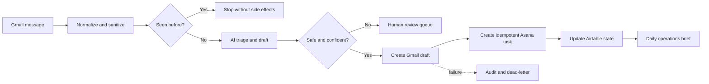

# AI Inbox and Business Operations Command Center

[](https://github.com/aahil62/n8n-ai-inbox-operations/actions/workflows/validate.yml)

Safe AI inbox triage, Gmail draft review, Asana handoff and operations reporting in n8n. Turns incoming email into controlled drafts, tasks, review queues, and operating briefs without allowing the model to send free-form email.

## Verified proof

| Evidence | Verified result |
|---|---|
| Runtime path | Representative end-to-end path passed |
| External systems | n8n, Gmail, Airtable, Asana, and an OpenAI-compatible model endpoint |
| AI boundary | AI classifies and drafts; deterministic safety and confidence gates decide whether downstream actions are allowed. Customer replies are never automatically sent. |
| Duplicate behavior | A controlled replay stopped before creating a second draft or task. |
| Production boundary | Controlled test environment using fictional data |

Controlled live paths passed for normal Gmail processing, duplicate replay, and sensitive or prompt-injection review routing. The accepted path created a reviewable Gmail draft, an Asana task, and Airtable state without automatically sending the AI-written reply.

This is representative live-path evidence, not a claim that every production scenario has passed.

## Architecture



## Business process and reliability

- canonical input normalization and explicit validation
- idempotency or stable record mapping before side effects
- deterministic rules around irreversible business actions
- confidence and human-review gates where AI is used
- capped retries for transient failures
- audit records, dead-letter handling, and replay paths
- destination verification before a record is marked successful
- inactive workflow exports with credentials removed

## Test evidence

- [Test report](docs/test-report.md)
- [Test plan and remaining matrix](docs/test-plan.md)
- [Verification boundaries](docs/verification.md)

15 end-to-end scenarios plus a labeled 40-message triage evaluation set.

## Workflow package

| ID | Workflow | Responsibility |
|---|---|---|
| P2-01 | [`p2-inbox-intake.json`](workflows/p2-inbox-intake.json) | Gmail intake, normalization, sanitization, message deduplication |
| P2-02 | [`p2-triage-draft-core.json`](workflows/p2-triage-draft-core.json) | Structured triage, grounded draft, safety gates, review-queue creation |
| P2-03 | [`p2-review-task-handoff.json`](workflows/p2-review-task-handoff.json) | Accepted-message Gmail draft and Asana handoff; downstream failure preservation |
| P2-04 | [`p2-daily-operations-brief.json`](workflows/p2-daily-operations-brief.json) | Fact-based daily brief from stored state |
| P2-05 | [`p2-retention-health-sweep.json`](workflows/p2-retention-health-sweep.json) | Retention cleanup and health reporting |
| P0-99 | [`shared-error-handler.json`](workflows/shared-error-handler.json) | Shared audit, alert, redaction, and dead-letter handling |

## Controlled E2E reference workflows

These inactive exports capture the callable workflow chain used for the newer
controlled Gmail, duplicate, and safety-path tests. They complement the stable
master package above; the harnesses and callable copies are not additional
production entry points.

| ID | Workflow | Responsibility |
|---|---|---|
| P2-E2E-00 | [`p2-e2e-00-test-harness.json`](workflows/e2e-reference/p2-e2e-00-test-harness.json) | Manual normal-path test harness |
| P2-E2E-00R | [`p2-e2e-00-review-test-harness.json`](workflows/e2e-reference/p2-e2e-00-review-test-harness.json) | Manual safety and review-path test harness |
| P2-E2E-01 | [`p2-e2e-01-gmail-adapter.json`](workflows/e2e-reference/p2-e2e-01-gmail-adapter.json) | Corrected Gmail Trigger adapter |
| P2-E2E-01C | [`p2-e2e-01c-processor.json`](workflows/e2e-reference/p2-e2e-01c-processor.json) | Canonical email processor with duplicate protection |
| P2-E2E-02 | [`p2-e2e-02-triage-core.json`](workflows/e2e-reference/p2-e2e-02-triage-core.json) | Callable AI triage and safe-draft core |
| P2-E2E-03 | [`p2-e2e-03-handoff.json`](workflows/e2e-reference/p2-e2e-03-handoff.json) | Callable Gmail draft, task, and owner-alert handoff; urgent delivery branch remains unverified |
| P2-E2E-04 | [`p2-e2e-04-daily-brief.json`](workflows/e2e-reference/p2-e2e-04-daily-brief.json) | Callable daily operations brief |
| P2-E2E-05 | [`p2-e2e-05-retention-health.json`](workflows/e2e-reference/p2-e2e-05-retention-health.json) | Callable retention and health sweep |


## Known limit

Four of the 15 end-to-end scenarios have passed. The remaining 11 scenarios and the labeled 40-message evaluation set have not been run live as a complete production gate.

## Review the repository

- [Architecture](docs/architecture.md)
- [Data contract](docs/data-contract.md)
- [Setup guide](docs/setup.md)
- [Placeholder map](docs/placeholder-map.md)
- [Test plan](docs/test-plan.md)
- [Test report](docs/test-report.md)
- [Verification and limitations](docs/verification.md)
- [Sanitized fixtures](fixtures)
- [Configuration samples](config)
- [Repository usage terms](USAGE.md)


## Import and test

1. Import `workflows/shared-error-handler.json` into a test n8n instance.
2. Import the project workflows.
3. Follow [the placeholder map](docs/placeholder-map.md) and reconnect sub-workflow IDs.
4. Create credentials inside n8n. Do not place secrets in workflow JSON.
5. Validate every workflow and keep it inactive.
6. Run the fixtures against disposable accounts before enabling schedules or webhooks.

Run the repository check locally:

```bash
node scripts/validate-repository.mjs
```

## Portfolio context

This repository is a sanitized engineering case study by [Aahil Sayed](https://github.com/aahil62). It is designed to show workflow architecture, reliability decisions, test coverage, and reusable integration patterns. Client deployments still require account-specific field mapping, credentials, acceptance criteria, and production testing.
