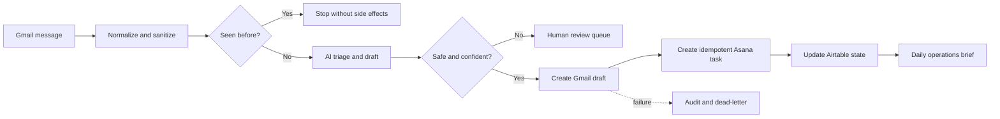

# AI Inbox and Business Operations Command Center

Safe AI inbox triage, Gmail draft review, Asana handoff and operations reporting in n8n.

## Business outcome

Turns incoming email into controlled drafts, tasks, review queues, and operating briefs without allowing the model to send free-form email.

## Stack

n8n, Gmail, Airtable, Asana, OpenAI-compatible models, JavaScript

## Architecture



## Workflow package

| ID | Workflow | Responsibility |
|---|---|---|
| P2-01 | [`p2-inbox-intake.json`](workflows/p2-inbox-intake.json) | Gmail intake, normalization, sanitization, message deduplication |
| P2-02 | [`p2-triage-draft-core.json`](workflows/p2-triage-draft-core.json) | Structured triage, grounded draft, confidence and safety gates |
| P2-03 | [`p2-review-task-handoff.json`](workflows/p2-review-task-handoff.json) | Gmail draft, Asana task, review queue, replayable failures |
| P2-04 | [`p2-daily-operations-brief.json`](workflows/p2-daily-operations-brief.json) | Fact-based daily brief from stored state |
| P2-05 | [`p2-retention-health-sweep.json`](workflows/p2-retention-health-sweep.json) | Retention cleanup and health reporting |
| P0-99 | [`shared-error-handler.json`](workflows/shared-error-handler.json) | Shared audit, alert, redaction, and dead-letter handling |

## Reliability controls

- canonical input normalization and explicit validation
- idempotency or stable record mapping before side effects
- deterministic rules around irreversible business actions
- confidence and human-review gates where AI is used
- capped retries for transient failures
- audit records, dead-letter handling, and replay paths
- destination verification before a record is marked successful
- inactive workflow exports with credentials removed

## Verified scope

A representative Gmail message passed through AI triage, grounded draft creation, Airtable tracking, and Asana task handoff.

This is representative live-path evidence, not a claim that every production scenario has passed.

## Known limit

The full 15-scenario failure matrix and the labeled 40-message evaluation set are included but have not been run live as a complete production gate.

## Review the repository

- [Architecture](docs/architecture.md)
- [Data contract](docs/data-contract.md)
- [Setup guide](docs/setup.md)
- [Test plan](docs/test-plan.md)
- [Test report](docs/test-report.md)
- [Verification and limitations](docs/verification.md)
- [Sanitized fixtures](fixtures)


## Import and test

1. Import `workflows/shared-error-handler.json` into a test n8n instance.
2. Import the project workflows.
3. Replace every `REPLACE-...` placeholder and reconnect sub-workflow IDs.
4. Create credentials inside n8n. Do not place secrets in workflow JSON.
5. Validate every workflow and keep it inactive.
6. Run the fixtures against disposable accounts before enabling schedules or webhooks.

Run the repository check locally:

```bash
node scripts/validate-repository.mjs
```

## Portfolio context

This repository is a sanitized engineering case study by [Aahil Sayed](https://github.com/aahil62). It is designed to show workflow architecture, reliability decisions, test coverage, and reusable integration patterns. Client deployments still require account-specific field mapping, credentials, acceptance criteria, and production testing.
