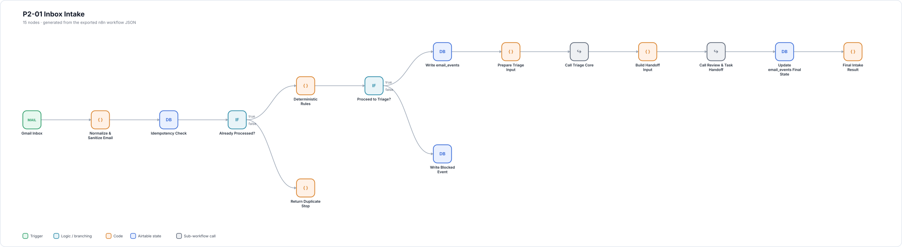
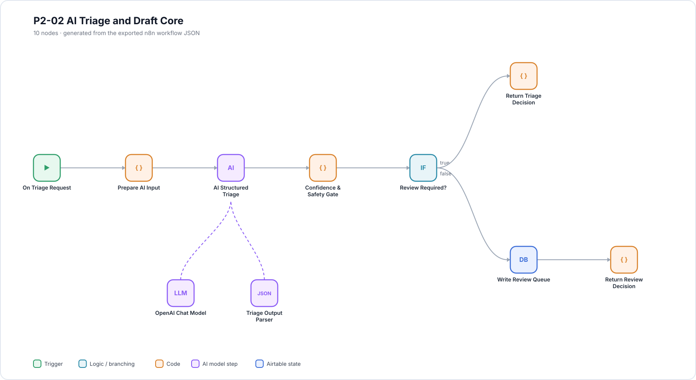
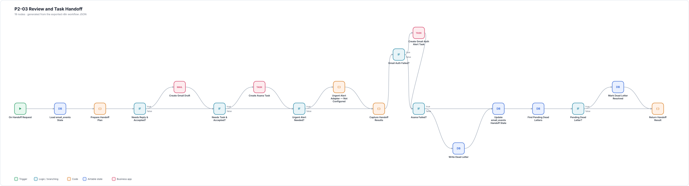
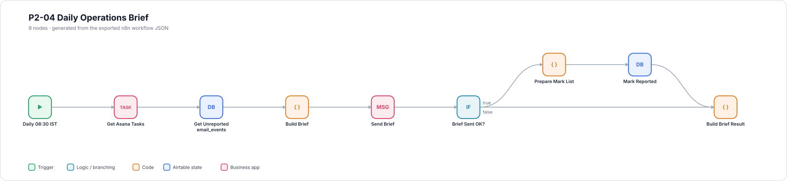
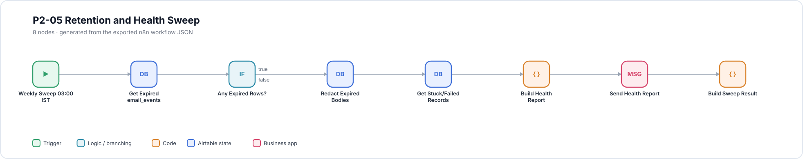
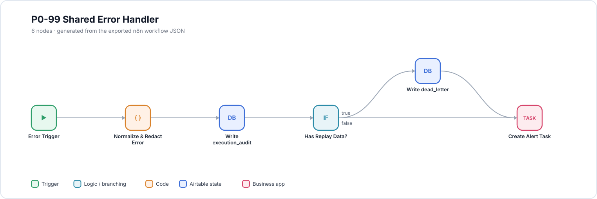

# Workflow maps

Each map is generated from the exported workflow JSON in [`workflows/`](../workflows) by
[`scripts/render-workflow-maps.mjs`](../scripts/render-workflow-maps.mjs). They show the
node layout, branches and AI sub-nodes exactly as they import into n8n. Open an image
to view it at full size.

Regenerate after changing a workflow:

```bash
node scripts/render-workflow-maps.mjs
```

## P2-01 Inbox Intake

Gmail intake, clean-up, duplicate check and fixed rules, then calls to triage and handoff.



## P2-02 AI Triage and Draft Core

Structured AI triage and draft, confidence and safety gate, review queue.



## P2-03 Review and Task Handoff

Gmail draft, Asana task, urgent-alert placeholder and dead-letter handling.



## P2-04 Daily Operations Brief



## P2-05 Retention and Health Sweep



## P0-99 Shared Error Handler


